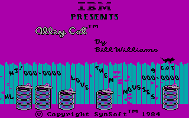

# Alley Cat — browser port

A faithful, playable port of the 1984 IBM PC game *Alley Cat* to HTML, CSS and vanilla
JavaScript. It is a translation of the original program's behaviour, not an emulator:
every routine is reimplemented in JavaScript and runs against the original data.



**No game data is included** (apart from the screenshot above). You need your own copy of the original `CAT.EXE`
(IBM PC version, SHA-256 `4979c886…7bfdd`). The browser reads it locally: graphics,
sound tables and texts come from that file at runtime and are never uploaded or stored
anywhere except, if you tick the box, in your own browser's IndexedDB.

## Play online

- **Game:** https://vorticoncmdr.github.io/re-alleycat/ — choose your `CAT.EXE`
  (optionally tick "remember" to keep it in this browser).
- **Asset viewer:** https://vorticoncmdr.github.io/re-alleycat/viewer.html — open `CAT.EXE`
  and/or `TANDYCAT.EXE` with "Open files" to browse sprites, text, the title tune and raw data.

Both pages run entirely in your browser; the files you choose are never uploaded.

## Play locally

```sh
npm run serve        # http://127.0.0.1:8000/
```

Open the page, choose `CAT.EXE`, then:

- arrow keys / numeric keypad (diagonals 7 9 1 3) move the cat, Alt = special action
- Esc pause, Ctrl+S sound, Ctrl+R restart, Ctrl+M menu (also as buttons below the screen)
- touch: an on-screen pad (shown on touch devices, or switch it on in Settings)
- gamepad: stick/D-pad move, A/B = Alt, Start = Esc, Select = Space; answer Y to the
  joystick question to play in the original's joystick mode

Settings (remembered per browser): scaling (fit / integer), touch pad, machine profile
(DOSBox reference, or an approximate IBM PC/XT), fullscreen.

URL options: `?seed=1234` fixes the random seed (hex), `?cycles=3000` changes the
virtual CPU speed (instructions per millisecond), `?profile=ibmpc` picks a profile.

## Status

See [docs/STATUS.md](docs/STATUS.md). Short version: the whole game is playable (title,
menu, alley, all seven rooms, game over), verified byte-for-byte against the original in
DOSBox. The Tandy 1000 edition (`TANDYCAT.EXE`) is analysed but not ported.

## Verify

Requires Node 20+ and, for the browser checks, Chrome/Chromium (`CHROME_PATH` to override).
Put your `CAT.EXE` into `game/` (ignored by git) or set `ALLEYCAT_GAME_DIR`.

```sh
npm run verify       # all required checks; non-zero exit on any failure
```

## Layout

- `src/machine/` — the virtual PC the game sees: clock (BIOS ticks, PIT, retrace),
  memory, CGA, PC speaker, keyboard, the BIOS services it calls.
- `src/game/` — the translated game, one function per original routine (named by
  their original code offsets in comments).
- `src/ui/` — browser shell: loading, canvas, input, audio, persistence.
- `tests/`, `tools/` — verification and reverse-engineering tooling.
- `docs/` — architecture, reverse-engineering notes with evidence levels, status.

## Licence

The port's own code is MIT licensed. *Alley Cat* itself is © 1984 IBM / Bill Williams;
you must own a copy to use this port.
